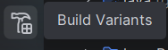

# Reto 2 · Enigma (CriptoApp)

Aplicación Android que **descifra imágenes cifradas con AES-256-GCM** y **textos cifrados con César**, con una interfaz de pergamino, multiidioma (español, inglés y euskera) y la premisa de no dejar nunca el resultado guardado en el dispositivo.

---

## Generacion de APKs

### APK de debug

Seleccionaremos las rayas de al lado del nombre del proyecto, en el apartado ``Build`` seleccionamos ``Generate App Bundles or APKs`` y despues en ``Generate APKs``.

Nos saldra a la derecha una ventana diciendo de que ya se ha creado nuestra ``APK``, pulsaremos ``locate`` azul para que nos muestre la carpeta en la que esta nuestra ``APK`` lista para instalar.

### APK release sin firmar
En el panel de la izquierda pulsaremos este icono:



Nos aparecera el menu de la ``Build Variant``s, ahi pulsaremos en el desplegable que pone ``debug (default)`` y seleccionaremos ``release``.

(Si no muestra el desplegable con un click haremos doble click)

Despues haremos los mismos pasos que para sacar una de debug.

Seleccionaremos las rayas de al lado del nombre del proyecto, en el apartado ``Build`` seleccionamos ``Generate App Bundles or APKs`` y despues en ``Generate APKs``.

Nos saldra a la derecha una ventana diciendo de que ya se ha creado nuestra ``APK``, pulsaremos ``locate`` azul para que nos muestre la carpeta en la que esta nuestra ``APK`` lista para instalar.

### APK release/debug firmada

Seleccionaremos las rayas de al lado del nombre del proyecto, en el apartado ``Build`` seleccionamos ``Generate Signed App Bundles or APKs``, despues seleccionaremos ``APK``, a continuacion nos saldra para introducir los parametros de nuestra ``Key`` (Esta no es la misa que la ``API_KEY``) si no tenemos creamos una, y despues seleccionamos si va a ser una ``APK`` de ``debug`` o una ``release`` y le daremos a ``Create``.

Nos saldra a la derecha una ventana diciendo de que ya se ha creado nuestra ``APK``, pulsaremos ``locate`` azul para que nos muestre la carpeta en la que esta nuestra ``APK`` lista para instalar.

## Características

### Descifrado AES (imágenes)
- Importa un archivo `.png.enc` (formato **R2AE v1**).
- Pide una contraseña de **16 caracteres alfanuméricos**, con botón de ojo para mostrarla u ocultarla.
- Descifra en segundo plano con barra de progreso y mensajes de estado.
- Muestra la imagen recuperada en pantalla previa; **nunca** se copia a Descargas ni a la galería: vive en la caché privada de la app y se borra al salir de la pantalla, al cerrar la app o al cambiar de vista.
- Tamaño limite de 200MB

### Descifrado César (textos)
- Importa un `.txt` y aplica un desplazamiento de **1 a 25** (el campo solo admite ese rango).
- Desplaza cada carácter ASCII imprimible (32–126), de modo que los espacios y dígitos cifrados vuelven a su sitio.
- Aplica **un único desplazamiento a todo el archivo**.
- Límite de **200 KB** por archivo: por encima se muestra el aviso «Archivo demasiado grande» en vez de intentar leerlo.

### Interfaz
- Tema de pergamino con botones en relieve que se aplastan al pulsar.
- Diseño adaptativo: layouts propios para vertical y horizontal, con medidas por configuración y sin scroll en pantallas habituales.
- Respeta las barras del sistema, el recorte de cámara y el teclado (insets).
- Desplegable de idioma en el menú (español, inglés, euskera) que persiste y recrea la actividad.
- Diálogos de **Acerca de** (menú) y **Ayuda** (pantallas AES y César, botón `?`).
- Todos los textos de la interfaz están en recursos `strings.xml`; no quedan cadenas en el código.

---

## Requisitos

| Elemento | Valor |
|---|---|
| SDK mínimo | 30 (Android 11) |
| Lenguaje | Kotlin |
| Dependencias | AndroidX Activity, AppCompat 1.8, Core-KTX, ConstraintLayout, Material |

---

## Estructura del proyecto

```
android/
  app/src/main/
    java/com/dm2/enigma/
      MainActivity.kt              # pantallas, idioma, avisos y ciclo de vida
      Descifradores/
        DescifrarAes.kt            # contenedor R2AE v1: AES-256-GCM + PBKDF2
        DescifrarCesar.kt          # descifrado César de .txt (límite 200 KiB)
    res/
      layout/  layout-land/        # pergamino en vertical y horizontal
      values/  values-en/  values-eu/   # textos, colores, medidas, arrays
      drawable/  drawable-land/    # pergamino, botones, iconos (vectores)
```

Las carpetas `docs/`, `python-cli/`, `javafx/` y `unity/` quedan reservadas para el resto de entregables del reto.

---

## Formato del contenedor R2AE v1

Cabecera de **37 bytes**:

| Bytes | Contenido |
|---|---|
| 0–3 | `R2AE` (magic) |
| 4 | versión (1) |
| 5–8 | iteraciones PBKDF2 (200 000, big endian) |
| 9–24 | sal de 16 bytes |
| 25–36 | nonce GCM de 12 bytes |

Después van el texto cifrado y una **etiqueta GCM de 16 bytes** al final. La clave es de 32 bytes, derivada con **PBKDF2-HMAC-SHA256** (200 000 iteraciones); la cabecera se valida antes de derivar la clave y se usa como AAD.

El texto se escribe primero en un archivo `.part` que solo se publica cuando la etiqueta se autentica: una contraseña incorrecta no deja ningún archivo.

Límite del contenedor: **100 MiB**.

---

## Privacidad

- El resultado del descifrado AES solo existe en la caché privada de la app y se elimina en `onStop`, `onDestroy` y al cambiar de pantalla.
- El texto descifrado con César solo vive en memoria.
- No se escriben permisos de almacenamiento ni se exportan archivos a carpetas públicas.

---

## Autores

Reto 2 de DAM — grupo **Koldo, Kenneth y Carlos**.
